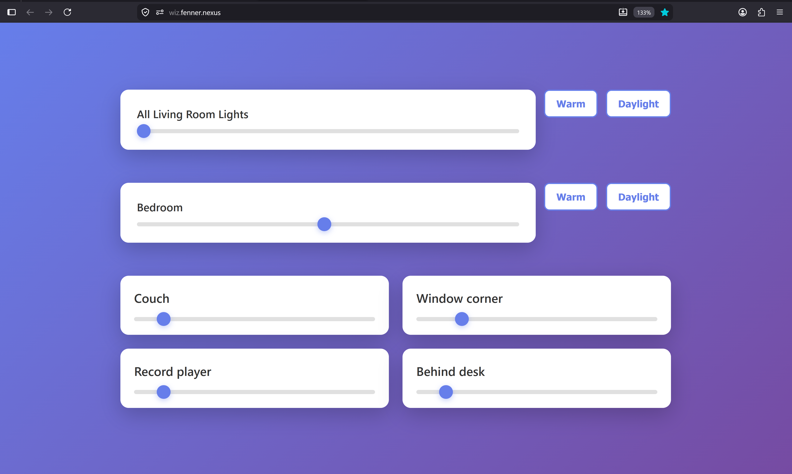

# WiZ Controller

A lightweight, local-first web app that lets anyone on my home network control my [WiZ smart lights](https://www.wizconnected.com) without installing proprietary vendor apps or giving IoT devices internet access.

---

## Why This Exists

As documented in my [homelab](https://github.com/mitchfen/homelab), **no IoT devices are allowed internet access on my network**. 

WiZ smart lights communicate over local UDP on port `38899` using a straightforward JSON-RPC protocol. Rather than forcing housemates or guests to install a bloated, account-driven mobile app that tries to phone home to cloud servers, this service runs as a small container on my Kubernetes cluster (`Draynor`) and exposes an instant, responsive interface to anyone on the Wi-Fi.

## How It Works

- **Go Backend**: Serves fast, server-rendered HTML and communicates directly with bulbs over UDP.
- **HTMX Reactivity**: Sliders, toggles, and scene buttons swap HTML fragments over HTTP with zero heavy JavaScript frameworks.
- **Local UDP Protocol (`38899`)**: Sends direct `getPilot` and `setPilot` JSON payloads to each bulb's local IP address. Commands are retried with small backoffs for reliable delivery over Wi-Fi.
- **In-Memory Cache & Polling**: The Go server maintains an in-memory cache updated instantly on user actions and periodically polled every 10 seconds, so sliders are always accurate when opening the app on a new device.
- **Progressive Web App (PWA)**: Includes a web app manifest and mobile app icons so it can be installed directly to an iOS or Android home screen with no browser chrome.
